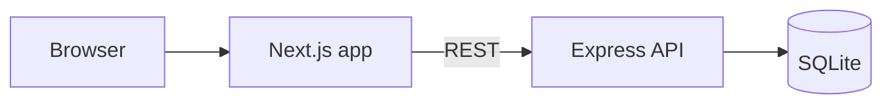

# ACME Salary Management

A web app that lets an HR manager maintain salary records for 10,000 employees across multiple countries and answer questions about how the organization pays people.

**Stack:** Node.js, TypeScript, Express, SQLite (API) · Next.js, React, shadcn/ui (web)

## Live demo

- App: https://salary-management-lyart.vercel.app/

The API runs on a free host, so the first request after a quiet period can take about a minute to wake up. The database reloads 10,000 seeded employees on restart, so anything added while testing will eventually reset. See the trade-offs below.

## What it does

- **Employees:** add, edit and delete records (name, email, job title, department, country, salary, currency, hire date).
- **Find people fast:** search by name or email, filter by one or more countries, departments and job titles, sort, and page through results. All of this runs on the server.
- **Insights:** headcount, minimum, median, average and maximum salary grouped by country, department or job title, with the same filters.

## Architecture



- `api/` Express API. Routes handle HTTP, zod validates input, and repository and list modules run the SQL.
- `web/` Next.js app with an employees page and an insights page.
- `docs/` requirements, design notes and AI workflow log.

## Run it locally

You need Node 20 or newer.

```
# API (http://localhost:4000)
cd api
npm install
npm run seed      # creates salary.db with 10,000 employees
npm run dev

# Web (http://localhost:3000), in a second terminal
cd web
npm install
echo NEXT_PUBLIC_API_URL=http://localhost:4000 > .env.local
npm run dev
```

Useful settings for the API: `PORT`, `DB_PATH` (database file, default `salary.db`) and `SEED_COUNT` (default 10000).

## Tests

```
cd api && npm test    # validation, data layer, search/filter/pagination, insights, endpoints
cd web && npm test    # formatting and query helpers
```

API tests use an in-memory SQLite database, so they are fast and deterministic.

## API

| Endpoint | Purpose |
|---|---|
| `GET /api/employees` | List with `search`, `country`, `department`, `jobTitle` (repeat a key for several values), `sortBy`, `sortDir`, `page`, `pageSize` |
| `POST /api/employees` | Create an employee |
| `GET, PATCH, DELETE /api/employees/:id` | Read, partially update, delete |
| `GET /api/insights/salary` | Salary statistics, `groupBy=country\|department\|jobTitle` plus the same filters |
| `GET /api/options` | Distinct countries, departments and job titles for the filter lists |

## Key decisions

- **No currency conversion.** Salaries are stored in local currency and every insights row is split by currency, so no number ever mixes currencies. Conversion would be a business decision about which rates to use.
- **Server-side paging, filtering and aggregation.** The browser holds one page of 25, and the insights query runs in the database.
- **Integer salaries**, a unique email enforced by the database, and a whitelist for sort and group columns, so no user input becomes SQL.
- **Deterministic seed data** from a fixed random seed, so tests and demos are repeatable.

More detail is in [`docs/requirements.md`](docs/requirements.md), [`docs/design-notes.md`](docs/design-notes.md) and [`docs/ai-workflow.md`](docs/ai-workflow.md).

## Known limitations

- Free hosting: the deployed database resets on restart and reloads the seeded data. For production I would use hosted Postgres or a persistent disk.
- No authentication, salary history or Excel import/export. These were left out on purpose and are explained in the requirements document.
- Sorting by salary mixes currencies, which